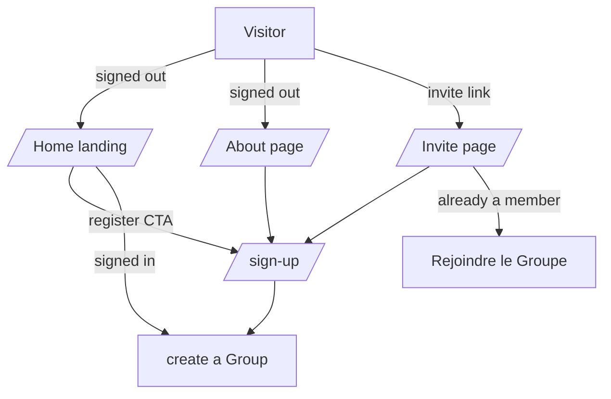

# Ardoise public entry experience - Plan

## Goal Capsule

- **Objective:** A stranger who reaches Ardoise — cold on the domain, or warm on an invite link — can, before signing up, grasp what the app does and why joining is trustworthy, then follow a truthful path into registering and creating a first Group.
- **Product authority:** ce-brainstorm dialogue 2026-09-06 (TituxMetal/FORK-ardoise); CONTEXT.md vocabulary governs copy and identifiers; current product state verified in `apps/web` and `apps/api` (registration open, joining an existing Group invite-gated).
- **Open blockers:** none.

## Product Contract

### Summary

Give Ardoise a public, pre-sign-up front door: a thin landing at `/` that sells a minimum and funnels to free registration, a dedicated `/about` that explains the model through an anchored lexicon plus the honest boundaries, and a short instanced explanation on the invite page. These three surfaces sit on a new public routing-and-shell layer; the rest of the app stays behind the session wall.

### Problem Frame

Ardoise has no acquisition or explanation surface. A logged-out visitor on any route meets a bare sign-in/sign-up card, and the invite page — the one organic path — names the Group and member count but explains nothing about what a stranger would be joining. The app is open-access by design, yet that fact is neither visible nor demonstrable, and no French positioning copy exists anywhere in the product. A friend-of-a-friend or a domain walk-in therefore has no reason to register, which keeps the app from ever becoming usable by a real circle.

### Requirements

**Public routes and shell**

- R1. `/about` becomes an open route reachable without a session, rendered in a public shell.
- R2. `/` shows the landing to signed-out visitors and keeps showing the groups list to signed-in users.
- R3. Non-public routes keep today's session gate: a signed-out visitor on any route other than `/`, `/about`, and `/invite` still lands on the auth card.
- R4. The public shell shows the brand and links between the landing, About, and sign-in, without exposing app chrome or its destinations to signed-out visitors.

**Home — the front door**

- R5. The landing pitches Ardoise concisely in its French register, anchored on the core idea that balances derive from what members record rather than being typed in.
- R6. The landing states the truthful open-access offer: creating an account and a first Group is free and needs no invitation.
- R7. A primary CTA on the landing leads to registration; a fresh account lands on the create-a-Group screen as it does today.

**About — the anchored lexicon and honest boundaries**

- R8. `/about` explains the domain model through an anchored lexicon — one entry per domain term (Groupe, Dépense, Service, Règlement, Solde, Invitation) — each a plain-French definition plus a one-line concrete slate example, with wording mirroring the app's own copy.
- R9. `/about` states the derivable-solde property and the honest boundaries: Groups are sealed rooms, balances never cross Groups, joining an existing Group is by a Member's secret invite, and Ardoise records and computes but holds and moves no money.
- R10. `/about` is reachable from the landing, from the invite page, and from the signed-in shell.

**Invite page**

- R11. The invite page shows a short instanced explanation above the join/sign-up wall — naming the Group being joined and that it is a shared slate whose balances derive — plus a link to `/about`.

**Register and copy**

- R12. Entry-flow and public copy uses consistent French register; the English-identifier leaks these surfaces expose are corrected to one canonical form the lexicon mirrors (e.g. the sign-up submit «Créer un User», and the «Mes groupes»/«Mes Groupes» casing).

### Key Decisions

- **Extend the existing router and shell rather than introduce a new surface.** The SPA route union, path resolvers, and `AppLayout` already own routing and the signed-out minimal shell; opening public pages extends that capability. Governs R1–R4.
- **Three public surfaces together.** `(session-settled: user-directed — chosen over a single surface or deferring the cold door: a cold domain visitor is an intended open-access user, so a real pre-login door exists.)` Governs R1–R7, R11.
- **Home sells thin, About carries the depth.** `(session-settled: user-directed — chosen over merging the About into the home: cold and invited readers arrive at different depths, and a dedicated page is wanted alongside a landing.)` Governs R5–R10.
- **Lexicon anchors each term in a concrete example.** `(session-settled: user-approved — chosen over a pure glossary, a narrated story, or a playable demo: mirroring the real UI grounds each term, and a demo stays deferred until the product demonstrably works.)` Governs R8.
- **Correct the register leaks on the touched surfaces rather than mirror current copy.** `(session-settled: user-directed — chosen over strict mirroring: the new pages would otherwise inherit and broadcast the leaks.)` Governs R12.
- **Say the truth about open access and invites.** `(session-settled: user-directed — chosen over sell-first copy: overclaiming invites churn.)` Governs R6, R9.

### Key Flows

- F1. Cold entry. A signed-out visitor reaches `/`, reads the pitch and the free-offer line, follows the primary CTA to registration, signs up, and lands on the create-a-Group screen.
  - **Covers:** R2, R5, R6, R7
- F2. Invited entry. A visitor opens an invite link, sees the Group name and member count plus the instanced explanation, then joins directly if a member or registers and joins through the existing wall.
  - **Covers:** R11
- F3. Deep read. A visitor opens `/about` from the landing, the invite page, or the signed-in shell, reads the lexicon and the boundaries, then returns to the entry point or a register CTA.
  - **Covers:** R8, R9, R10

### Acceptance Examples

- AE1. Logged-out on `/` shows the landing pitch and a register CTA, not the auth card. Covers R2, R5, R6.
- AE2. Signed-in on `/` shows the groups list as today. Covers R2.
- AE3. Logged-out on a non-public route (e.g. `/profile`) shows the auth card as today. Covers R3.
- AE4. Logged-out on `/about` reads the page without being redirected to auth. Covers R1.
- AE5. On the invite page, a signed-out visitor sees the instanced explanation above sign-up/sign-in; a member sees it above Rejoindre le Groupe. Covers R11.
- AE6. Each lexicon entry's example wording matches the corrected on-screen noun for that concept. Covers R8, R12.

### Scope Boundaries

- **In scope:** the landing, the `/about` page, the invite-page graft, the public routing-and-shell enabler, and register corrections on the surfaces the entry flow touches — the sign-up copy («Créer un compte»/«Créer le compte»), the «Mes Groupes» casing (list heading and nav DESTINATIONS), and the slate-tab relabel («Remboursements» → «Règlements», «Ajouter un Remboursement» → «Ajouter un Règlement»).
- **Deferred for later:** a playable demo / "show a slate"; first-run teaching on a brand-new empty Group; and a repo-wide single French copy source that reconciles every remaining copy divergence across all screens — only the entry-flow leaks above are corrected here, and the lexicon teaches a canonical term while the wider cleanup is deferred.

### Outstanding Questions

Resolved by grill 2026-09-06 (shared understanding confirmed); canonical forms recorded in ADR 0007.

- **Sign-up noun:** «Créer un compte» / «Créer le compte» (was «Créer un/le User»). Not a domain concept → outside the About lexicon.
- **Casing:** «Mes Groupes» everywhere — list heading and nav DESTINATIONS (was «Mes groupes»).
- **Payback term:** «Règlement» is canonical; the slate tab and add-label are relabelled «Règlements» / «Ajouter un Règlement» and pulled into scope so the lexicon and the screen agree.
- **Register boundary:** CONTEXT.md `_Avoid_` lists constrain identifiers and agent-authored English, not French UI copy.

### Sources / Research

- `docs/ideation/2026-09-06-about-page-ideation.html` — ranked directions this plan selects among.
- `CONTEXT.md` — authoritative vocabulary; French reserved for UI copy.
- `apps/web/src/main.tsx` — session gate routing signed-out visitors to `AuthPage`.
- `apps/web/src/lib/router.tsx` — `Route` union and Hono path resolvers.
- `apps/web/src/layouts/AppLayout.tsx` — signed-out minimal shell and signed-in `DESTINATIONS`.
- `apps/web/src/pages/InvitePage.tsx` — current invite preview and join/sign-up wall.
- `apps/api/src/createApp.ts` — auth wall: registration open, `/groups/*` session-gated.
