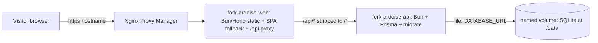

# Ardoise VPS Docker deployment - Plan

> Grill session 2026-09-07 settled the open decisions: image/service naming (`fork-ardoise-*` derived from the repo `TituxMetal/FORK-ardoise`), the web runtime (Bun/Hono static+proxy server, not nginx), the exact Portainer compose, the CI publish pattern (mirrors the operator's `car-cost-tracker` house workflow), the better-auth proxy semantics behind the reverse proxy, and the backup/restore path (house rsync volume backup). These replace the earlier nginx guess and the `trustHost`/TLS-cookie wording in KD6/R5.

## Goal Capsule

- **Objective:** An operator can run Ardoise in production on one of their VPS by pasting one compose file into Portainer — following the house conventions (pre-existing external networks, images pulled from the GitHub registry, named volume) — and the app is reachable over HTTPS at its hostname with registration, Invites, Groups, Expenses and Paybacks working, data surviving restarts and redeploys, and a documented backup/restore path.
- **Product authority:** ce-brainstorm dialogue 2026-09-06 (FORK-ardoise); operator infra conventions supplied in that dialogue and verified against the operator's production project `car-cost-tracker` (`docker/compose.yaml`, `docker/Dockerfile.api`/`.web`, `.github/workflows/ci.yml` — house Docker/Portainer/CI shape); current product state verified in `apps/web` and `apps/api` (registration open, joining an existing Group invite-gated, API root-mounted, web clients call `/api`).
- **Open blockers:** none.

## Product Contract

### Summary

Containerize Ardoise into two images — `fork-ardoise-api` (Bun + Prisma) and `fork-ardoise-web` (a Bun/Hono server that serves the production static build behind a proxy that forwards `/api` to the API) — publish them to the GitHub container registry (`ghcr.io/tituxmetal/fork-ardoise-api` / `fork-ardoise-web`, images stay on GitHub like the operator's other apps), and ship a Portainer-ready compose file that matches the operator's existing network and volume conventions. Two small config changes make the stack trustworthy behind the reverse proxy: better-auth's base URL and trusted origins are driven by env so it accepts the public HTTPS origin and emits secure cookies, and Prisma CLI + runtime resolve the same `DATABASE_URL`.

### Problem Frame

The repo has zero deployment artifacts: Ardoise currently runs only through `vp dev` on a workstation, and production would silently inherit the localhost dev defaults (SQLite file in the repo, better-auth trusted origins hardcoded to `http://localhost:1337`, Prisma CLI targeting a repo-relative file). The app's shape still fits the operator's standard stack — two processes (API + web), a single-file SQLite database, better-auth sessions — so the work is packaging and configuration plus one small server in `apps/web`, not an infrastructure redesign. Nothing about the app forces a deviation from the house Portainer pattern.

### Key Decisions

- **KD1. Portainer stack, not a bespoke host setup.** The operator runs Docker through Portainer and manages apps as stacks; a single compose file that he pastes into Portainer is the delivery shape. No Dockerfile or compose exists in the repo today, so the stack ships with this work. Governs R9.
- **KD2. Two images, one origin; web serves via Bun, not nginx.** API and web stay separate containers (`fork-ardoise-api`, `fork-ardoise-web`), mirroring the operator's full-stack apps (`car-cost-tracker`). One public hostname terminates TLS at NPM and reaches only the web container; a small Bun/Hono server inside `fork-ardoise-web` serves the static build, answers client-route deep links with the SPA fallback, and proxies `/api/*` to the API internally with the prefix stripped. This follows the operator's Bun-only house runtime (his Hono-only project and `car-cost-tracker` web both serve through Bun, never nginx). Governs R2, R4.
- **KD3. House networks, volume, timezone and restart conventions, verbatim.** Both containers join the pre-existing external networks `reverse-proxy-nw` and `default-nw` exactly as the operator's other stacks do — never recreated, never renamed — with `restart: unless-stopped`, host timezone mounted read-only (`/etc/localtime`, `/etc/timezone`), a named stack-scoped volume `data:` mounted at `/data`, and `${VAR}` env injection from the Portainer stack. `DATABASE_URL` is a stack var (the Dockerfile default is only a fallback). Governs R9.
- **KD4. Images stay on the GitHub registry, pulled by Portainer from there.** Builds and publication run on GitHub Actions as a docker job mirroring the house `car-cost-tracker` workflow: a matrix over `api`/`web`, `docker/Dockerfile.api` + `docker/Dockerfile.web` at the repo root, buildx cache from GitHub Actions, login to `ghcr.io` with `GITHUB_TOKEN` (the repo owner `TituxMetal` owns the registry namespace, so no PAT is needed), and metadata tags `latest`, `prod` and `sha-<hash>` pushed on every push to `main` — never from PRs. Images stay on GHCR as `ghcr.io/tituxmetal/fork-ardoise-api` and `ghcr.io/tituxmetal/fork-ardoise-web`; the operator pulls them in Portainer (whose global registry credentials already reach GHCR) and clicks "update stack" — the CI never deploys directly. Governs R3.
- **KD5. SQLite on a named volume; migrations and runtime target the same file.** The database is a single SQLite file addressed by an absolute `file:` URL in `DATABASE_URL` on the mounted volume at `/data`. Today `apps/api/prisma.config.ts` hardcodes `file:./prisma/dev.db` for the CLI while the runtime reads `DATABASE_URL` — in a container they would migrate and serve different files, so the config must read the URL from env. Verified against Prisma 7.9: `prisma migrate deploy` opens the `file:` DSN directly through its own schema engine (no driver adapter wiring belongs in `prisma.config.ts`; adapters are a generated-client runtime concern), and libsql's SQLite-compatible file is safe to migrate and serve interchangeably. Governs R6, R7.
- **KD6. better-auth trusts the public HTTPS origin; secure cookies come from the base URL, not from the request scheme.** better-auth (verified against installed `^1.6.29`) has **no `trustHost` option** (that is NextAuth vocabulary); origin trust is `trustedOrigins` and proxy-header trust is `advanced.trustedProxyHeaders`. The cookie `Secure` flag is decided at init from config, never from the observed protocol or `X-Forwarded-Proto`: resolution order is `useSecureCookies` > dynamic base URL protocol > static `baseURL` `https://` prefix > `NODE_ENV === 'production'`. Because the web→API hop is plain HTTP, the correct lever is a static `https` `baseURL`: with `BETTER_AUTH_URL` set to the public origin, better-auth emits `Secure` cookies unconditionally, with no forwarded-header requirement and no `X-Forwarded-*` propagation needed through the web proxy. The adapter change: derive `trustedOrigins` from env (the public origin is auto-added in 1.6.29, so the https origin needs no manual entry) instead of the hardcoded `http://localhost:1337`, keep that dev origin only when `BETTER_AUTH_URL` is unset, and leave `baseURL = process.env.BETTER_AUTH_URL ?? 'http://localhost:3000'` as it already is. No CORS is needed: everything is single-origin. Governs R5.
- **KD7. Baseline is a reliable instance, not a trial.** The operator deploys Ardoise among production apps, so restart policy, persistent volume, migrations-on-boot and a documented backup/restore path are in scope from the start. Migrations run on boot behind a house `RUN_MIGRATIONS` toggle (literal `'true'` in the stack while the schema is expected to evolve; the operator removes it in Portainer once a release is stable). Governs R8, R10.

### Requirements

**Packaging & images**

- R1. The repo ships a `fork-ardoise-api` image: Bun runtime (`oven/bun:1.3.14-alpine`), Prisma client generated at build, Prisma schema, migrations and `prisma.config.ts` bundled, non-root user, data at `/data`. A `docker/start.sh` runs `prisma migrate deploy` (only when `RUN_MIGRATIONS=true`, against `$DATABASE_URL`, failing fast so the restart policy retries) then starts `bun src/main.ts` on `PORT=3000`.
- R2. The repo ships a `fork-ardoise-web` image: the production build of `apps/web` (`vp build` → `apps/web/dist`) bundled with a small Bun/Hono server (new code in `apps/web`) that serves the static build, returns `index.html` for client-route deep links (the app is a History-API SPA with paths `/`, `/groups/:id`, `/invites/:secret`, `/profile`, `/session`), and forwards `/api/*` to the API at `$API_URL` with the `/api` prefix stripped — the same contract as the dev proxy in `apps/web/vite.config.ts`, whose `rewrite` removes the prefix because the API is root-mounted (`apps/api/src/createApp.ts`).
- R3. A GitHub Actions docker job builds both images and publishes them to the GitHub container registry as `ghcr.io/tituxmetal/fork-ardoise-api` and `ghcr.io/tituxmetal/fork-ardoise-web` — images stay on GitHub. It mirrors the house `car-cost-tracker` publish job: a matrix over `api`/`web`, `docker/Dockerfile.api` + `docker/Dockerfile.web` (context `.`), buildx cache from GitHub Actions, GHCR login with `GITHUB_TOKEN`, and `docker/metadata-action` tags `latest`, `prod` and `sha-<hash>` enabled only on pushes to the default branch (`main`) — never on PRs.

**Routing & origin**

- R4. Production is single-origin: one hostname terminates TLS at Nginx Proxy Manager and forwards to the `fork-ardoise-web` container only; pages, `/api/*` data calls and auth calls all stay on that origin, and the API container is never exposed directly.
- R5. The API trusts the public origin behind the proxy. `BETTER_AUTH_URL` is the public `https` origin, making it better-auth's static `baseURL`; better-auth then sets `Secure` cookies regardless of the internal HTTP transport, and the https origin is accepted automatically. `trustedOrigins` is driven by env instead of the hardcoded `http://localhost:1337` (the localhost dev origin applies only when `BETTER_AUTH_URL` is unset). No `trustHost` (it does not exist in better-auth), no `X-Forwarded-*` propagation requirement, no CORS — single-origin. Required config change in `apps/api/src/shared/infrastructure/auth.adapter.ts`.

**Data & migrations**

- R6. The SQLite database file lives on the named stack volume `data:` at `/data`, addressed by an absolute `file:` path in `DATABASE_URL`, and survives container recreate and stack redeploy.
- R7. Prisma CLI and the runtime resolve the same database: `apps/api/prisma.config.ts` reads the URL from env instead of the hardcoded `file:./prisma/dev.db`, and `docker/start.sh` runs `prisma migrate deploy` against `$DATABASE_URL` before serving when `RUN_MIGRATIONS=true`, failing fast so the restart policy retries.
- R8. A documented backup/restore procedure lets the operator recover the data on a fresh volume. Ardoise adds **no per-app backup tooling**: the database lives on a Docker named volume already covered by the operator's house manual `rsync` script, which copies Docker volumes on each server from the operator's machine. The runbook documents the volume name and that restore means restoring that volume (Groups, Expenses, Services, Paybacks and Invites come back; Balances re-derive identically from the restored records).

**Deployment surface & operations**

- R9. The compose file follows the house conventions verbatim (mirrors `car-cost-tracker/docker/compose.yaml`): both containers join the pre-existing external networks `reverse-proxy-nw` and `default-nw` unchanged, `restart: unless-stopped`, host timezone mounted read-only, the named volume `data:` mounted at `/data`, and env values as `${VAR}` from the Portainer stack — paste-and-run in Portainer. Stack env: `DATABASE_URL` (api, `file:/data/ardoise.db`), `BETTER_AUTH_URL` (api, the public `https` origin), `BETTER_AUTH_SECRET` (api), `RUN_MIGRATIONS` (api, literal `'true'` while the schema evolves), `API_URL` (web, `http://fork-ardoise-api:3000`).
- R10. A runbook documents first deploy, update, and restore: a push to `main` publishes the images → create the stack in Portainer with the env values → point an NPM host at the web container over HTTPS → verify registration, a Group, an Invite, an Expense and a Payback → update is republish (new `main` push) plus a Portainer stack redeploy that re-pulls `prod`, with migrations re-run while `RUN_MIGRATIONS` is set, and data survives → restore is restoring the backed-up volume.

### Actors

- A1. Operator — creates the Portainer stack, supplies env values, creates the NPM host.
- A2. Nginx Proxy Manager — terminates TLS for the hostname, forwards to the web container.
- A3. Web container — Bun/Hono server serving the static build with SPA fallback and proxying `/api` to the API.
- A4. API container — auth, slate data, migrations.
- A5. Visitor — signs up, joins a Group by Invite link, records Expenses, Services and Paybacks.

### Key Flows

- F1. First deploy
  - **Trigger:** Operator has published the images and chosen a VPS and hostname.
  - **Actors:** A1, A2, A3, A4
  - **Steps:** A1 pastes the compose file into a new Portainer stack and sets the env values; the API container runs pending migrations against the empty volume (while `RUN_MIGRATIONS` is true) and starts; A1 points the NPM host at the web container over HTTPS; A1 verifies the acceptance paths.
  - **Outcome:** A visitor reaches Ardoise over HTTPS and the full slate loop works; data is on the named volume.
- F2. Update to a new version
  - **Trigger:** A new push to `main` has published new images to the GitHub registry.
  - **Actors:** A1, A4
  - **Steps:** A1 redeploys the Portainer stack and re-pulls `prod`; the API container runs `prisma migrate deploy` again before serving while `RUN_MIGRATIONS` is set; the web container serves the new build.
  - **Outcome:** New code live, pending migrations applied, existing data intact.
- F3. Restore from backup
  - **Trigger:** Data loss or a fresh VPS.
  - **Actors:** A1
  - **Steps:** A1 stands up the stack with an empty volume, lets migrations run, then restores the database volume from the house rsync backup per the documented procedure.
  - **Outcome:** Groups, Expenses, Services, Paybacks and Invites match the backup; Balances re-derive identically.

### Acceptance Examples

- AE1. **Covers R4, R5.** Given a fresh visitor on the HTTPS hostname, when she registers, creates a Group, copies the Invite link, and a second User registers and joins by that link and records an Expense and a Payback, then both sessions persist across reloads and the slate matches on both accounts.
- AE2. **Covers R6, R7.** Given an empty volume, when the stack first boots, all migrations apply and the API then serves; when the stack is redeployed with the same volume, Groups and Expenses created earlier are still there.
- AE3. **Covers R8.** Given the house rsync backup taken of the running instance's Docker volumes, when the operator restores the database volume onto a fresh volume, the Groups, Expenses, Services, Paybacks and Invites match the backup and Balances re-derive identically.
- AE4. **Covers R2, R4.** Given the stack behind NPM, when the operator requests `https://<hostname>/api/<route>`, the request reaches the API with the prefix stripped, and the API container has no path exposed from NPM other than through the web container; a deep link like `https://<hostname>/groups/<id>` reloads to the app, not a 404.

### Success Criteria

- A colleague who has never read the source can stand Ardoise up on a fresh VPS from the runbook and compose file alone — no repo knowledge required.
- The full loop (registration → Group → Invite → Expense/Service/Payback) works over HTTPS against the deployed stack, exercised at deploy time per the runbook checklist.

### Scope Boundaries

- The choice of VPS and public hostname is the operator's run-time input; the compose file and runbook are host-agnostic.
- Not in scope: multi-replica or horizontal scaling, moving data off SQLite to a managed database, CI auto-deploy to the server (the CI only builds and publishes images; updates stay a Portainer stack redeploy pulling from the GitHub registry), monitoring or alerting beyond the existing stack (Portainer + restart policy), and anti-abuse/rate-limit hardening beyond what the app already does.
- Not in scope: product feature work — registration stays open by design, per the separate public-entry experience plan; invites keep gating membership in existing Groups.

### Outstanding Questions

None resolve before planning.

Resolved during the 2026-09-07 grill session (previously deferred; now decisions above):

- GHCR package visibility and the publish trigger — resolved: images stay private on the GitHub registry; `GITHUB_TOKEN` suffices for the push (repo owner `TituxMetal` owns the `ghcr.io/tituxmetal` namespace); Portainer's global registry credentials already reach GHCR, so no per-app credential work; publication is automatic on every `main` push, never from PRs (KD4, R3).
- Exact better-auth behavior behind the proxy — resolved against `^1.6.29`: no `trustHost`; `Secure` cookies come from a static `https` base URL, not the request scheme; `trustedOrigins` env-driven (KD6, R5).
- The static server choice inside the web image — resolved: a Bun/Hono server (house Bun-only runtime, matching the operator's other apps), not nginx; build output is `apps/web/dist` (KD2, R2).

### Sources / Research

- `apps/api/src/shared/infrastructure/auth.adapter.ts:7-16` — better-auth config: `baseURL` already env-driven (`BETTER_AUTH_URL ?? 'http://localhost:3000'`), `trustedOrigins` hardcoded to `['http://localhost:1337']`, no `trustHost` (better-auth has none), email/password open.
- `apps/api/prisma.config.ts` — CLI datasource hardcoded to `file:./prisma/dev.db`.
- `apps/api/src/shared/infrastructure/prisma.client.ts:6-9` — runtime `PrismaClient` over the `PrismaLibSql` adapter (`@prisma/adapter-libsql`), `DATABASE_URL` with a repo-file fallback; libsql's SQLite-compatible file is migrated and served interchangeably.
- `apps/api/prisma/schema.prisma` — `provider = "sqlite"`; better-auth tables (`User`, `Account`, `Session`, `Verification`) share the same database, so a volume backup also restores auth.
- `apps/web/vite.config.ts:12-17` — dev `/api` proxy stripping the prefix (the production routing contract).
- `apps/api/src/createApp.ts:32-46` — all routes mounted at root, auth at `/auth/*`.
- `apps/web/src/lib/router.tsx`, `apps/web/src/main.tsx` — History-API SPA; client routes `/`, `/groups/:id`, `/invites/:secret`, `/profile`, `/session` (deep links need the SPA fallback).
- `apps/web/package.json` — `"build": "vp build"`; `vite-plus` is a root devDependency so `vp` runs inside the Docker build stage; output is Vite's default `apps/web/dist`.
- `apps/api/package.json` — `prisma:deploy: prisma migrate deploy`; `apps/api/src/main.ts` — `Bun.serve` on `PORT ?? 3000`, root `/ping`.
- Prisma 7.9 CLI (local `node_modules`) — `prisma migrate deploy`/`generate` connect via the native schema engine to the `file:` DSN; `prisma.config.ts` has no adapter surface (verified `@prisma/config` type); driver adapters are a generated-client runtime concern only.
- `.github/workflows/ci.yml` — the existing validate workflow to extend with a docker publish job.
- Operator-supplied conventions from the production project `car-cost-tracker` (`docker/compose.yaml`, `docker/Dockerfile.api`/`.web`, `.github/workflows/ci.yml` on `develop`) — compose shape (external `reverse-proxy-nw` + `default-nw` on both containers, named `data:` volume at `/data`, host timezone mounts, `restart: unless-stopped`, `${VAR}` injection, `RUN_MIGRATIONS` toggle), multi-stage Bun Dockerfiles in `docker/`, and the GHCR matrix publish job with `latest`/`prod`/`sha-` tags on default-branch pushes. car-cost-tracker's same-origin `/api` server-side proxy and its env-pinned secure cookies are the reference for the Ardoise auth topology; note its `__Secure-` cookie-prefix pitfall with `advanced.useSecureCookies` is avoided here (single origin, Secure driven by the https base URL).
- better-auth `^1.6.29` source and docs — `Secure` cookie flag decided at init from config (never the observed scheme); no `trustHost`; `trustedOrigins`/`advanced.trustedProxyHeaders` split; the https origin is auto-added to trusted origins.
